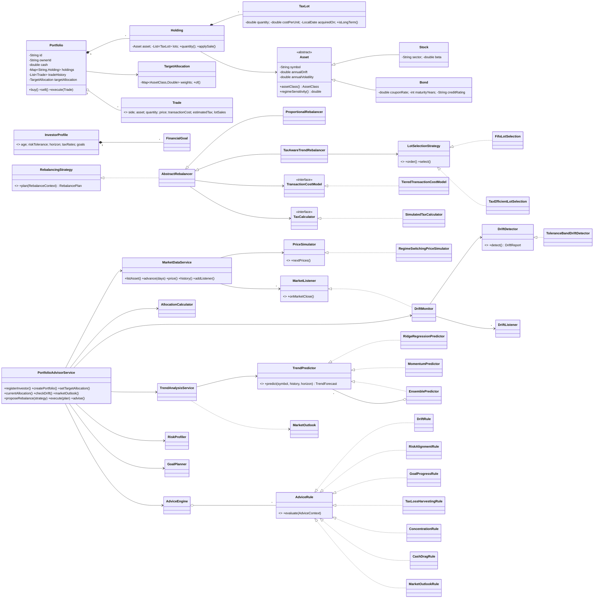
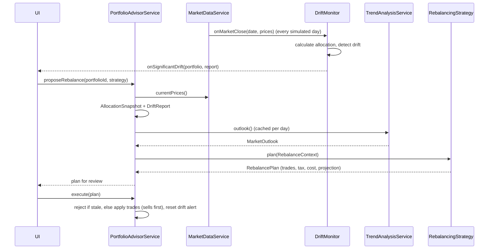

# Low-Level Design: Financial Portfolio Rebalancing Advisor

## 1. Requirements → components

| # | Functional requirement | Component(s) | Key class(es) |
|---|---|---|---|
| 1 | Model stocks and bonds with simulated prices | `model`, `market` | `Asset` ← `Stock`, `Bond`; `MarketDataService`; `RegimeSwitchingPriceSimulator` |
| 2 | Users define target asset allocations | `model` | `TargetAllocation` (validated, immutable) |
| 3 | Calculate the current allocation | `allocation` | `AllocationCalculator` → `AllocationSnapshot` |
| 4 | AI model to predict trends and recommend rebalancing | `prediction`, `rebalancing` | `RidgeRegressionPredictor`, `MomentumPredictor`, `EnsemblePredictor`, `TaxAwareTrendRebalancer` |
| 5 | Automated detection of significant drift | `drift` | `ToleranceBandDriftDetector`, `DriftMonitor` (observer of the market) |
| 6 | Optimal buy/sell considering transaction cost and tax | `cost`, `tax`, `rebalancing` | `TieredTransactionCostModel`, `SimulatedTaxCalculator`, `TaxEfficientLotSelection`, `TaxAwareTrendRebalancer` |
| 7 | Personalised advice from risk tolerance and goals | `advice` | `RiskProfiler`, `GoalPlanner`, `AdviceEngine` + `AdviceRule`s |

## 2. Package layout

```
com.portfolio.advisor
├── model          Domain entities & value objects (no dependencies on other packages)
├── market         Simulated clock, prices, price history, market observers
├── prediction     Feature engineering + forecasting models (the "AI")
├── allocation     Portfolio valuation by asset class / symbol
├── drift          Drift measurement, severity, automated monitoring
├── cost           Transaction-cost models
├── tax            Tax calculation and tax-lot selection
├── rebalancing    Rebalancing strategies and plans
├── advice         Risk profiling, goal planning, rule-based advice
│   └── rules      One class per advice rule
├── service        Facade (PortfolioAdvisorService) + composition root (AdvisorFactory)
└── util           LinearAlgebra (Gaussian elimination, clamp)
```

Dependencies point one way: `service` → everything; `rebalancing`/`advice` → `prediction`, `drift`, `tax`, `cost`, `allocation`; all → `model`. `model` depends on nothing.

## 3. Class diagram



## 4. Design patterns used (and why)

| Pattern | Where | Why |
|---|---|---|
| **Strategy** | `PriceSimulator`, `TrendPredictor`, `DriftDetector`, `TransactionCostModel`, `TaxCalculator`, `LotSelectionStrategy`, `RebalancingStrategy` | Every "policy" can be swapped without touching callers, e.g. plug in an LSTM predictor or a real broker fee schedule. |
| **Template Method** | `AbstractRebalancer.plan()` | The rebalancing skeleton (target → sells → budgeted buys → projection → tax) is fixed; subclasses only decide *which* assets and lots to trade. |
| **Composite** | `EnsemblePredictor` | An ensemble *is a* `TrendPredictor`, so callers cannot tell one model from many. |
| **Observer** | `MarketDataService` → `MarketListener` (`DriftMonitor`) → `DriftListener` | Drift detection runs automatically on each market close without the market knowing about portfolios. |
| **Chain of rules / Specification** | `AdviceEngine` + `AdviceRule` | New advice = new class; the engine is closed for modification (OCP). |
| **Facade** | `PortfolioAdvisorService` | One entry point for a UI or REST controller; hides wiring. |
| **Factory / Composition root** | `AdvisorFactory`, `TargetAllocation.of(...)` | Concrete classes are picked in one place; the static factory validates invariants. |
| **Parameter object** | `RebalanceContext`, `AdviceContext` | Strategies and rules get one immutable bundle instead of long argument lists. |
| **Immutable value objects** | `record`s: `Trade`, `LotSale`, `TrendForecast`, `DriftReport`, `RebalancePlan`, … | Thread-safe, easy to reason about, safe to cache. |

SOLID in practice: each class has one job (SRP). New models, rules or strategies are new classes (OCP). `ProportionalRebalancer` and `TaxAwareTrendRebalancer` can be swapped anywhere a `RebalancingStrategy` is expected (LSP). Interfaces are small, mostly one method (ISP). High-level services depend on interfaces injected by `AdvisorFactory` (DIP).

## 5. Key algorithms

### 5.1 Market simulation (`RegimeSwitchingPriceSimulator`)
Geometric Brownian motion with a shared market factor and a hidden Markov regime (BULL / SIDEWAYS / BEAR):

```
r_i = (μ_i + β_i·regimeDrift)·dt + β_i·σ_m·√dt·Z_m + σ_i·√dt·Z_i
P_i(t+1) = P_i(t) · exp(r_i − σ_i²·dt/2)
```
The regimes persist, so prices contain trends a model can learn. Bonds have a slightly negative β (flight to quality). The generator is seeded, so every run is reproducible.

### 5.2 The AI trend model (`RidgeRegressionPredictor`)
* **Features** (`FeatureExtractor`): 5/20/60-day returns, 10/50 moving-average gap, 20-day volatility, and RSI-14, plus a bias term.
* **Label:** the forward return over `horizonDays` (21 by default).
* **Training:** closed-form ridge regression `w = (XᵀX + λI)⁻¹ Xᵀy`, solved with Gaussian elimination. The bias term is not penalised.
* **Honest confidence:** the model is fit on the oldest 75% of samples. Its directional hit rate on the newest 25% becomes `confidence = clamp(2·(hitRate − 0.5), 0, 1)`. It is then refit on all samples for the live forecast. A model that is no better than a coin flip gets confidence 0 and has no influence.
* **Ensemble:** the ridge forecast is combined with a rule-based momentum model, weighted by confidence. Confidence is reduced when the models disagree on direction.
* **Consumption:** `score = expectedReturn × confidence` is the single number the rebalancer uses.

### 5.3 Drift detection (`ToleranceBandDriftDetector`, "5/25 rule")
```
threshold(class) = min(absoluteBand, relativeBand × target)     // 5 pts or 25% of target
|current − target| > threshold / 2  → MINOR
|current − target| > threshold      → SIGNIFICANT (rebalance)
|current − target| > 2 × threshold  → CRITICAL    (rebalance even if tax is high)
```
`DriftMonitor` listens to every market close. It alerts only when severity escalates, so a portfolio that stays drifted does not send repeated alerts. It re-arms once the portfolio is back inside its bands or has been rebalanced.

### 5.4 Tax-aware rebalancing (`TaxAwareTrendRebalancer`)
1. **AI tilt:** `tilt = clamp(2 × (stockScore − bondScore), ±cap)`. The cap is 1/2/3 points for conservative, moderate and aggressive investors. It stays well inside the 5-point drift band, so the long-term target is kept.
2. **What to sell:** holdings in the overweight class are ranked by `taxPerDollar(cheapest lot) + forecastScore`. This is the cost of selling $1 plus the expected return given up. The lowest penalty is sold first, so losers and bearish names go before big winners.
3. **Which lots:** `TaxEfficientLotSelection` sorts lots by tax per unit: short-term losses first, then long-term losses, then long-term gains, then short-term gains. Lots whose tax exceeds `maxMarginalTaxRate` (8%) of proceeds are kept unless drift is CRITICAL, and the plan records that in its notes.
4. **What to buy:** bearish assets are excluded. The top 3 candidates are weighted by `1 + 20·score`.
5. **Budget:** buys are limited to cash above the cash target, including the proceeds of the sells. Quantities are whole units and transaction costs are included, so the plan never overspends.
6. **Plan output:** the trades (sells before buys), the projected weights, the netted tax impact (short- and long-term, losses offsetting gains), turnover, total friction and plain-English notes.

`ProportionalRebalancer` (FIFO lots, pro-rata trims, no forecasts) is the baseline. The demo prints both plans so the savings are visible.

### 5.5 Personalised advice
* `RiskProfiler`: equity % = 0.6 × risk-tolerance model + 0.4 × age glide path (110 − age), reduced for horizons under 7 years.
* `GoalPlanner`: goals are checked in date order. For each goal it computes the projected value, the funded ratio, the required return (by bisection) and the extra yearly saving needed.
* `AdviceEngine` runs 7 independent rules: drift, risk mismatch, goal shortfall, concentration, tax-loss harvesting (with a wash-sale warning), idle cash, and confident AI outlooks on assets you hold. Results are sorted by priority.

## 6. Main flows



## 7. Edge cases handled
* Target weights that do not sum to 1, or are negative → `IllegalArgumentException`.
* Buying without enough cash, or selling lots that are not in the holding → `IllegalStateException`.
* A plan executed on a later day than it was made → rejected as stale (prices have moved).
* Too little price history → neutral forecast with zero confidence, so it has no effect.
* Every forecast in a class is bearish → buy equally anyway, so the target still holds, and add a note.
* Small allocations (for example 5% cash) are protected by the relative band.
* Trades below the minimum trade value are skipped, so fees are not paid on tiny orders.

## 8. Extension points
* **Better AI:** implement `TrendPredictor` (gradient boosting, LSTM through ONNX, an external API) and add it to the `EnsemblePredictor`.
* **Real data:** implement a `PriceSimulator`, or replace `MarketDataService` with a feed-backed service.
* **Real tax rules:** implement `TaxCalculator` for a specific country (for example India's STCG/LTCG with its ₹1.25 lakh exemption), and add wash-sale tracking.
* **More asset classes:** add an `AssetClass` value and an `Asset` subclass (for example gold or REITs). The allocation, drift and planning code loops over `AssetClass.values()`.
* **Persistence and API:** put repository interfaces behind the maps in `PortfolioAdvisorService` and expose the facade over REST.

## 9. Deliberate simplifications
* Money uses `double` for readability. A production system would use `BigDecimal` or integer paise/cents.
* The service is single-process and in-memory. Maps are concurrent, but the outlook cache is guarded with `synchronized`.
* Taxes and fees are simulated flat rates, not real tax law.
